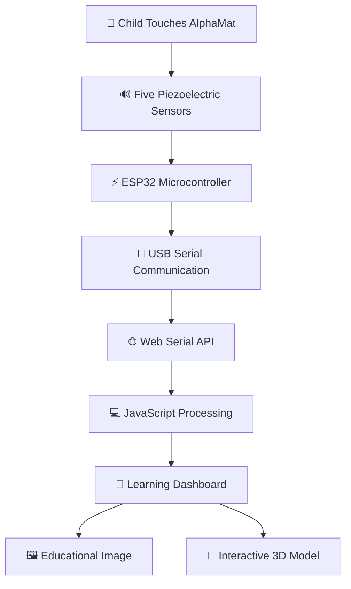

<!-- ================================================= -->
<!-- ALPHAMAT - SMART INTERACTIVE LEARNING SYSTEM      -->
<!-- ================================================= -->

<div align="center">


<a href="#">

</a>

<br/>


<br/><br/>

**An innovative interactive learning experience that connects physical touch with digital education.**

</div>

---

## ✨ About AlphaMat

**AlphaMat** is a smart interactive educational mat designed to make early childhood learning more engaging, practical and enjoyable.

Using five piezoelectric sensors connected to an ESP32 microcontroller, the system detects when a child touches an alphabet section on the physical mat.

The detected alphabet is transmitted to a web application through USB serial communication. The application automatically displays the corresponding alphabet, educational image, object name and interactive 3D model.

<div align="center">

### 🧠 TOUCH → ⚡ DETECT → 💻 DISPLAY → 🌍 EXPLORE

</div>

---

## 🚀 Key Features

<table>
<tr>
<td width="50%" align="center">

### ⚡ Smart Touch Detection
Five piezoelectric sensors detect physical interaction with the alphabet sections.

</td>
<td width="50%" align="center">

### 🔌 ESP32 Integration
ESP32 processes sensor signals and transmits alphabet information.

</td>
</tr>
<tr>
<td width="50%" align="center">

### 🌐 Live USB Communication
Real-time communication between ESP32 and browser using Web Serial API.

</td>
<td width="50%" align="center">

### 🎨 Dynamic Learning Interface
Automatically displays the detected alphabet and its corresponding content.

</td>
</tr>
<tr>
<td width="50%" align="center">

### 🧊 Interactive 3D Learning
Displays educational 3D models using Google Model Viewer.

</td>
<td width="50%" align="center">

### 📚 Hands-on Learning
Combines physical interaction with digital educational content.

</td>
</tr>
</table>

---

## 🔤 Explore the Alphabet World

<div align="center">

| Alphabet | Object | Learning |
|:---:|:---:|:---:|
| <h2>🅰️ A</h2> | Ant 🐜 | A for Ant |
| <h2>🅱️ B</h2> | Ball ⚽ | B for Ball |
| <h2>🌟 C</h2> | Cat 🐱 | C for Cat |
| <h2>🔵 D</h2> | Dog 🐶 | D for Dog |
| <h2>🅴 E</h2> | Elephant 🐘 | E for Elephant |

</div>

---

## 🏗️ System Architecture



---

## ⚙️ How AlphaMat Works

<div align="center">

| Step | Process | Description |
|:---:|---|---|
| 01 | 👆 Physical Touch | Child taps an alphabet section |
| 02 | ⚡ Sensor Detection | Piezoelectric sensor detects vibration |
| 03 | 🧠 Signal Processing | ESP32 identifies the sensor |
| 04 | 🔌 Data Transfer | Alphabet sent through USB serial |
| 05 | 🌐 Web Processing | Browser receives the alphabet |
| 06 | 🎯 Learning Display | Image, name and 3D model appear |

</div>

---

## 🔧 Hardware Components

| Component | Quantity | Purpose |
|---|:---:|---|
| ESP32 USB-C | 1 | Main microcontroller |
| Piezoelectric Sensors | 5 | Touch/vibration detection |
| Zero PCB | 1 | Electronic circuit mounting |
| Resistors | As required | Signal conditioning and protection |
| USB-C Cable | 1 | Laptop communication |
| Black Mat Base | 1 | Physical learning surface |
| Connecting Wires | As required | Circuit connections |

### 📍 ESP32 GPIO Mapping

| Alphabet | Sensor | GPIO |
|:---:|:---:|:---:|
| A | Piezo 1 | GPIO 32 |
| B | Piezo 2 | GPIO 33 |
| C | Piezo 3 | GPIO 34 |
| D | Piezo 4 | GPIO 35 |
| E | Piezo 5 | GPIO 36 |

*Pin mapping is intended for a compatible classic ESP32-WROOM development board. Verify the exact board and electrical protection before wiring.*

---

## 💻 Technology Stack

<div align="center">

### Hardware & Embedded


### Web Development


</div>

---

## 🎨 Physical Hardware Design

**Prototype Specifications**

- Single black rectangular mat.
- Approximate dimensions: 60 cm × 45 cm.
- Five alphabet sections arranged horizontally.
- Each section contains an alphabet, picture and object name.
- Five hidden piezoelectric sensors underneath the alphabet sections.
- ESP32 and zero PCB integrated underneath the mat.
- USB-C access for laptop connectivity.

<div align="center">

<!-- Replace with your actual hardware photograph -->


<sub>AlphaMat physical prototype – Replace this placeholder with your actual project image.</sub>

</div>

---

## 📂 Project Structure

```text
AlphaMat/
│
├── firmware/
│   └── AlphaMat_ESP32.ino
│
├── web/
│   ├── index.html
│   ├── assets/
│   │   ├── ant.png
│   │   ├── ball.png
│   │   ├── cat.png
│   │   ├── dog.png
│   │   └── elephant.png
│   │
│   └── models/
│       ├── ant.glb
│       ├── ball.glb
│       ├── cat.glb
│       ├── dog.glb
│       └── elephant.glb
│
├── screenshots/
│   ├── login.png
│   ├── dashboard.png
│   └── 3d-viewer.png
│
└── README.md
```

*Adjust this structure to match your actual repository.*

---

## 🛠️ Installation & Setup

### 1. Clone the Repository

```bash
git clone YOUR_GITHUB_REPOSITORY_URL
```

```bash
cd AlphaMat
```

### 2. Upload ESP32 Firmware

1. Open Arduino IDE.
2. Select your ESP32 board.
3. Select the correct COM port.
4. Open `AlphaMat_ESP32.ino`.
5. Upload the firmware.

### 3. Connect ESP32

Connect the ESP32 to your laptop using a USB-C data cable.

### 4. Run the Web Application

Open the web folder in VS Code and run:

```bash
python -m http.server 8000
```

Open:

```text
http://localhost:8000
```

### 5. Start Learning

1. Click Connect AlphaMat.
2. Select the ESP32 serial port.
3. Tap an alphabet on the physical mat.
4. Watch the corresponding learning content appear.

**Note:** Close Arduino Serial Monitor before connecting through the browser. Use a desktop Chrome or Edge browser with Web Serial support.

---

## 📸 Project Gallery

<div align="center">

### Physical Prototype


### Software Interface


### Interactive 3D Learning


</div>

*Replace the image placeholders with actual project screenshots.*

---

## 🔮 Future Scope

- Expand alphabet coverage from A to Z.
- Add fruits, animals, colors and shapes learning modes.
- Introduce interactive voice-based learning.
- Add multi-language educational support.
- Develop teacher and parent monitoring dashboards.
- Introduce learning progress tracking.
- Explore AI-powered personalized learning.

---

## 🎯 Applications

- Early childhood education.
- Interactive preschool learning.
- Activity-based educational environments.
- Smart educational toys.
- Digital and physical learning integration.

---

## 👨‍💻 Project Team

<div align="center">

| Team Member | Student ID |
|---|---|
| **Pratham Pimpalikar** | CM23031 |
| Yash Meshram | CM24D004 |
| Arpit Rangari | CM23032 |
| Tejas Kayarkar | CM23045 |

**Project Guide:** Ms. Swati Thakur

**Institution:** S. B. Jain Institute of Technology, Management and Research, Nagpur.

</div>

---

## 💙 Our Vision

<div align="center">


### ✨ TOUCH | EXPLORE | LEARN ✨

**Built with creativity, electronics and innovation.**


</div>
